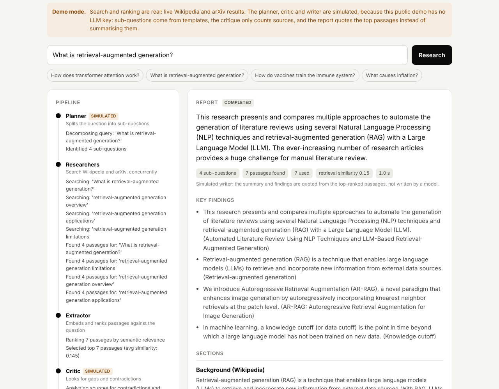
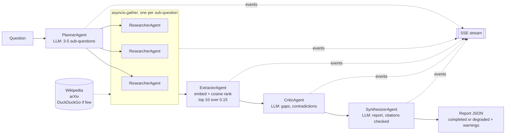

# Meridian — Multi-Agent Research Intelligence API

**Live demo: [meridian-nityashree.vercel.app](https://meridian-nityashree.vercel.app)** (real search and ranking; LLM stages simulated unless a key is set) · by [Nityashree S](https://nityashree.in)

> A five-stage research pipeline: an LLM splits your question into sub-questions, the sub-questions are searched concurrently, local embeddings rank the passages, an LLM reviews them for gaps and contradictions, and an LLM writes a structured report — with every stage streamed live over Server-Sent Events.

[](https://meridian-nityashree.vercel.app)

---

## The Problem

A basic retrieval system fires one query and returns one chunk. Meridian tries a broader approach: it splits the question, searches each part, ranks the evidence, asks an LLM to note gaps and contradictions, and shows each step as it happens. It has not been evaluated for answer quality yet.

---

## How It Works




```
POST /research  →  query arrives
                        │
              ┌─────────▼──────────┐
              │   PLANNER AGENT    │  LLM decomposes → 3-5 sub-questions
              └─────────┬──────────┘
                        │ sub-questions (parallel)
         ┌──────────────┼──────────────┐
         ▼              ▼              ▼
  ┌────────────┐ ┌────────────┐ ┌────────────┐
  │ RESEARCHER │ │ RESEARCHER │ │ RESEARCHER │  Wikipedia + arXiv + DuckDuckGo
  └──────┬─────┘ └──────┬─────┘ └──────┬─────┘
         └──────────────┼──────────────┘
                        │ all raw passages
              ┌─────────▼──────────┐
              │  EXTRACTOR AGENT   │  sentence-transformers cosine ranking
              └─────────┬──────────┘
                        │ top-k passages
              ┌─────────▼──────────┐
              │   CRITIC AGENT     │  LLM finds contradictions + gaps
              └─────────┬──────────┘
                        │
              ┌─────────▼──────────┐
              │ SYNTHESIZER AGENT  │  LLM builds final structured report
              └─────────┬──────────┘
                        │
              GET /research/{id}  →  full JSON report
```

Each step streams live to `GET /research/{id}/stream` as Server-Sent Events.

---

## The Live Demo

The public demo runs on Vercel's free tier with `DEMO_MODE=true` (see `app/demo_app.py`). It is built for a serverless function, so it differs from the full service:

| | Full service (`uvicorn main:app`) | Live demo (`DEMO_MODE=true`) |
|---|---|---|
| Search | Wikipedia, arXiv, DuckDuckGo | Same, live |
| Ranking | `all-MiniLM-L6-v2` embeddings (PyTorch) | Hashed bag-of-words embedder: lexical overlap, not meaning. PyTorch (about 5.6 GB) does not fit Vercel's 500 MB function limit |
| Planner, critic, writer | Groq LLM | **Simulated** when no `GROQ_API_KEY` is set: template sub-questions, a critique that only counts sources, and a report that quotes the top passages. The page and every report say so. Real when a key is set |
| API | Sessions in SQLite, background tasks, follow-ups, `/sessions` | One stateless call, `GET /api/research?q=...`, that streams every stage and ends with a `REPORT` event. No database and no session list, so visitors cannot see each other's questions |
| Guards | none (local use) | 12 questions an hour per visitor (per instance), questions up to 200 characters |

**To make the LLM stages real on the demo** (free): create a Groq API key at [console.groq.com](https://console.groq.com) and add it in the Vercel project settings as `GROQ_API_KEY`, then redeploy. The key lives only in Vercel's encrypted environment variables. The page then says "Live" and stops marking stages as simulated.

---

## Quick Start

```bash
git clone https://github.com/Nityaa08/meridian.git
cd meridian
pip install -r requirements-ml.txt     # core + sentence-transformers (PyTorch)

# Get a free Groq API key at https://console.groq.com
cp .env.example .env
# edit .env and set GROQ_API_KEY=your_key_here
# GROQ_MODEL defaults to openai/gpt-oss-20b (a Groq production model on 2026-11-02)

uvicorn main:app --reload
```

The first start downloads the `all-MiniLM-L6-v2` embedding model (about 90 MB). It runs on the CPU by default (`EMBEDDER_DEVICE=cpu`); see [Known Issues](#known-issues-checked-2026-11-13). `requirements.txt` alone installs the core service without PyTorch; the app then falls back to the lexical hashing embedder and logs a warning.

Run the demo version locally, with no key and no PyTorch:

```bash
pip install -r requirements.txt
DEMO_MODE=true EMBEDDER_BACKEND=hashing uvicorn main:app --reload
open http://localhost:8000
```

---

## Example Usage

```bash
# 1. Start a research session
curl -X POST http://localhost:8000/research \
  -H "Content-Type: application/json" \
  -d '{"query": "How does transformer attention work?"}'
# → {"session_id": "abc-123", "status": "running", "stream_url": "/research/abc-123/stream"}

# 2. Stream live agent events
curl -N http://localhost:8000/research/abc-123/stream
# → data: {"agent":"PlannerAgent","type":"PLANNING","message":"Identified 4 sub-questions",...}
# → data: {"agent":"ResearcherAgent","type":"SEARCHING","message":"Found 8 passages for: ...",...}
# → data: {"agent":"ExtractorAgent","type":"EXTRACTING","message":"Selected top 10 passages",...}
# → data: {"agent":"CriticAgent","type":"CRITIQUING","message":"Found 1 contradictions, 2 gaps",...}
# → data: {"agent":"SynthesizerAgent","type":"SYNTHESIZING","message":"Report complete. Confidence: 0.84",...}
#   ("Confidence" in this message is the retrieval similarity described below)
# → data: {"agent":"Orchestrator","type":"DONE",...}

# 3. Get the full report
curl http://localhost:8000/research/abc-123

# 4. Ask a follow-up (reuses already-fetched sources)
curl -X POST http://localhost:8000/research/abc-123/followup \
  -H "Content-Type: application/json" \
  -d '{"question": "How does multi-head attention differ from single-head?"}'

# 5. Health check
curl http://localhost:8000/health
# → {"status":"ok","embedder":"loaded","db":"ok","model":"openai/gpt-oss-20b","active_sessions":0}
```

---

## API Reference

| Method | Endpoint | Description |
|--------|----------|-------------|
| `POST` | `/research` | Start a new research session |
| `GET` | `/research/{id}/stream` | SSE stream of live agent events (replays the saved events once the session has finished) |
| `GET` | `/research/{id}` | Get status + final report |
| `POST` | `/research/{id}/followup` | Ask follow-up (reuses fetched sources) |
| `GET` | `/sessions` | List all sessions |
| `DELETE` | `/research/{id}` | Delete a session |
| `GET` | `/health` | System health + embedder status |
| `GET` | `/docs` | Interactive API docs (Swagger) |

---

## Final Report Structure

`confidence_score` is the retrieval similarity: the mean cosine similarity of the passages used. It is not a measure of correctness.

`status` is `completed` when every stage worked, `degraded` when a report was produced but something fell back (an LLM call failed, no source returned passages, or the Synthesizer cited a URL that was not retrieved), and `failed` when the pipeline raised an error. `report.warnings` lists what went wrong. Section `sources` only contain URLs of retrieved passages; any other URL the LLM writes is removed and counted in `warnings`.

```json
{
  "session_id": "uuid",
  "query": "original question",
  "status": "completed",
  "report": {
    "warnings": [],
    "summary": "2-3 sentence overview",
    "key_findings": ["finding 1", "finding 2", "finding 3"],
    "sections": [
      {"title": "...", "content": "...", "sources": ["url1", "url2"]}
    ],
    "sources": [
      {"title": "...", "url": "...", "relevance_score": 0.91}
    ],
    "confidence_score": 0.87,
    "gaps_identified": ["aspect not covered by available sources"],
    "contradictions": []
  },
  "metadata": {
    "agents_used": 5,
    "sources_searched": 14,
    "sources_used": 8,
    "total_time_ms": 8234
  }
}
```

---

## Agent Descriptions

| Agent | Role |
|-------|------|
| **PlannerAgent** | Uses Groq LLM to decompose the query into 3-5 focused sub-questions, ensuring full coverage of the topic. |
| **ResearcherAgent** | Runs once per sub-question, all sub-questions concurrently. Each run searches Wikipedia (MediaWiki Action API full-text search with intro extracts), then arXiv, then DuckDuckGo (via the `ddgs` package) only if fewer than 3 passages were found. Plain code, no LLM. |
| **ExtractorAgent** | Uses `sentence-transformers` to embed the query and passages in one call and rank them by cosine similarity; keeps passages with similarity at least 0.15 (0.05 for the demo's lexical embedder, whose cosines run lower), up to 10. Encode calls are serialised across sessions. Plain code, no LLM. |
| **CriticAgent** | Asks the Groq LLM to list contradictions, knowledge gaps and potentially unreliable sources in up to 8 passages. Its accuracy has not been evaluated. |
| **SynthesizerAgent** | Uses Groq LLM to build a structured report with summary, key findings, and cited sections. Retrieval similarity (the `confidence_score` field) = mean cosine similarity of the passages used. It measures how close the passages are to the question, not whether the report is correct. |

---

## Tech Stack

| Component | Tool | Why Free |
|-----------|------|----------|
| API framework | FastAPI + asyncio | Open source |
| LLM | Groq, OpenAI-compatible API (default `openai/gpt-oss-20b`; change with `GROQ_MODEL`) | Free tier, no credit card |
| Embeddings | sentence-transformers `all-MiniLM-L6-v2` | Local, open source, 90MB |
| Search | Wikipedia REST API + arXiv API | Official, no key needed |
| Search fallback | ddgs (successor of duckduckgo-search) | Free scraper library |
| Database | SQLite + aiosqlite | No external service |
| Streaming | sse-starlette | Open source |

---

## Architecture Notes

**Why SSE instead of WebSockets?** SSE is unidirectional (server → client), which matches this pattern exactly. Simpler to implement, works with `curl -N`, no handshake overhead.

**Why sentence-transformers locally?** Zero latency, no API quota, no cost. The `all-MiniLM-L6-v2` model (90MB) provides strong semantic search performance. Loaded once at startup via lifespan.

**Why multi-source search?** Wikipedia for factual overviews, arXiv for cutting-edge research/technical topics, DuckDuckGo as a fallback for recent or niche topics. No single source covers everything.

**Why asyncio.gather with return_exceptions=True?** One failing API call (DuckDuckGo rate limit, arXiv timeout) must not kill the entire pipeline. LLM-stage fallbacks are reported: the session ends `degraded` with `report.warnings`. A single failing search source is not reported on its own.

**Why sentence-transformers in asyncio.to_thread?** `encode()` is synchronous and CPU-bound. Running it directly in an async function blocks the entire event loop. `to_thread()` offloads it to a thread pool, and a lock keeps two sessions from encoding at the same time.

---

## Known Issues (checked 2026-11-13)

Fixed on 2026-11-02: the Apple Silicon crash (the embedder now runs on the CPU by default and embeds the query and passages in one call), the Wikipedia 404, the DuckDuckGo `Invalid impersonate` error, the retired default model, silent fallbacks, unchecked citations, the event log, and stale event queues. See the tests below for what was checked and how.

- **Not re-run against the live services.** The environment used for these fixes could not reach Groq, Wikipedia, DuckDuckGo, arXiv or Hugging Face. The fixes are covered by tests with fake services, and the new Wikipedia request follows the [MediaWiki Action API](https://www.mediawiki.org/wiki/API:Search) (`action=query&generator=search&prop=extracts`), but a real end-to-end run is still to do. The macOS fix follows the CPU workaround that passed 4 of 4 runs on 2026-10-28; it was not re-tested on a Mac.
- **Model choice.** `GROQ_MODEL` defaults to `openai/gpt-oss-20b`, the replacement Groq lists for `llama-3.1-8b-instant` on its [deprecations page](https://console.groq.com/docs/deprecations) and a production model on its [models page](https://console.groq.com/docs/models) (both checked 2026-11-02). It is a reasoning model, so the Synthesizer's `max_tokens` was raised to 4096. Groq retires models often; if `/research` ends `degraded` with a 404 from Groq, pick a current model from that page.
- **DuckDuckGo is a scraper.** `ddgs` can be rate-limited or break when the site changes; failures return no passages.
- **Citations are checked against URLs only.** The Synthesizer can only cite retrieved URLs now, but whether a cited passage supports the sentence is not checked.
- **A finished session's stream is a replay.** Once a session ends, `GET /research/{id}/stream` returns the saved events at once. The live queue of a session nobody streams is dropped 5 minutes after it finishes.
- **Streaming works across worker processes, with a short delay.** A running session's events are saved to the database as they happen (batched, at most every 0.5 s). If a stream request lands on a worker that isn't running the session, it follows those saved events instead of returning 404. On the worker that runs the session, events arrive instantly; on another worker they arrive up to about half a second later. With several workers on different machines, use a shared database instead of SQLite.
- **The full service is not deployable on Vercel serverless.** `sentence-transformers` pulls in PyTorch, so the install bundle is about 5.6 GB, above Vercel's 500 MB function limit. The live demo therefore runs the stateless demo app with the lexical hashing embedder (see [The Live Demo](#the-live-demo)); run the full service locally or in a container on a VM.
- **The demo's ranking and LLM stages are stand-ins.** Without a key, the planner, critic and writer are rules, not a model, and the demo's ranking measures word overlap. The demo shows the pipeline, streaming and citation checks working on live search results; it does not show answer quality.
- **No authentication or rate limit on the full service.** `/sessions` lists every user's queries. (The demo has neither endpoint and is rate limited.)

## Tests

```bash
pip install -r requirements-dev.txt
python -m pytest tests -v
```

39 tests, no network, Groq key or PyTorch needed: the Groq, Wikipedia and arXiv HTTP calls go to an in-process fake (`httpx.MockTransport`), DuckDuckGo is a fake `ddgs.DDGS`, and the embedder is a small bag-of-words stand-in. `tests/test_meridian.py` (24) covers the default model and CPU device, Wikipedia and DuckDuckGo parsing, one encode call per ranking and no parallel encodes across sessions, citation filtering, `degraded` status when the LLM is down, the saved event log, stream replay and queue cleanup, following a session that runs on another worker, saving progress while a session runs, and follow-ups. `tests/test_demo.py` (15) covers the hashing embedder (including that a relevant passage clears its relevance threshold) and its fallback, the simulated stages, and the demo endpoint: every stage streamed, a cited report, no LLM call without a key, real LLM calls with one, input limits, the rate limit, and that `main.py` exposes the demo `app` Vercel loads. They passed on 2026-11-13.

## Deployment

Live demo: Vercel (free tier), entrypoint `main.py`, Python 3.12 (`.python-version`), installing `requirements.txt` (no PyTorch). Environment variables: `DEMO_MODE=true`, `EMBEDDER_BACKEND=hashing`, and optionally `GROQ_API_KEY`. Every push to `main` redeploys.

---

Built by [Nityashree S](https://nityashree.in) · [GitHub](https://github.com/Nityaa08)
