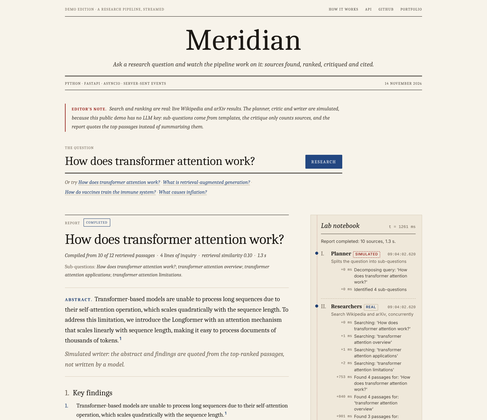
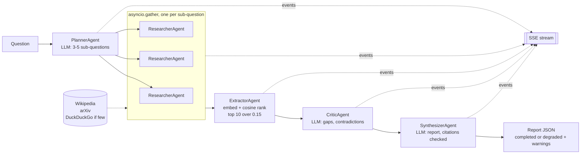

# Meridian — Multi-Agent Research Intelligence API

[](https://github.com/Nityaa08/meridian/actions/workflows/tests.yml)

**Live demo: [meridian.nityashree.in](https://meridian.nityashree.in)** (real search and ranking; LLM stages simulated unless a key is set) · by [Nityashree S](https://nityashree.in)

> A five-stage research pipeline: an LLM splits your question into sub-questions, the sub-questions are searched concurrently, local embeddings rank the passages, an LLM reviews them for gaps and contradictions, and an LLM writes a structured report — with every stage streamed live over Server-Sent Events.

[](https://meridian.nityashree.in)

## Run it in 1 minute

Needs Python 3.12 and `make`. Each command creates `.venv` on first use.

```bash
git clone https://github.com/Nityaa08/meridian.git && cd meridian

make demo                         # demo page at http://localhost:8000, no API keys needed
make test                         # 88 tests, no network or keys
GROQ_API_KEY=your_key make dev    # full mode: session API with real LLM stages (free key: console.groq.com)
```

In `make demo`, search and ranking are real (live Wikipedia and arXiv); the planner, critic and writer are simulated and marked as such on the page. Put a key in the environment or `.env` and the same page runs those stages on the LLM. `make dev` uses the lexical embedder unless you run `make ml` first (installs PyTorch, ~5.6 GB). Without `make`, see [Quick Start](#quick-start).

---

## In 60 seconds

| | |
|---|---|
| **Problem** | One search and one chunk rarely answer a real question, and an LLM answer rarely shows where it came from. |
| **What I built** | A five-agent research API: plan sub-questions, search Wikipedia and arXiv concurrently, rank passages with embeddings, critique, and write a cited report. Every stage streams live over Server-Sent Events. |
| **Evidence** | Every report carries a [grounding check](#grounding-check): each sentence is matched against the passages it cites, and the ones not found are listed. Citations to URLs that were not retrieved are removed. 88 tests with fake services, CI on every push. |
| **Engineering** | Python, FastAPI, asyncio fan-out, SSE that survives reconnects and multiple workers, embeddings (local or hashing), SQLite sessions, optional Groq LLM. |

## The Problem

A basic retrieval system fires one query and returns one chunk. Meridian tries a broader approach: it splits the question, searches each part, ranks the evidence, asks an LLM to note gaps and contradictions, and shows each step as it happens. Each report is checked for grounding (below), but answer quality has not been evaluated against a labelled set yet.

---

## How It Works




```
POST /research  →  query arrives
                        │
              ┌─────────▼──────────┐
              │   PLANNER AGENT    │  LLM decomposes → 3-5 sub-questions
              └─────────┬──────────┘
                        │ sub-questions (parallel)
         ┌──────────────┼──────────────┐
         ▼              ▼              ▼
  ┌────────────┐ ┌────────────┐ ┌────────────┐
  │ RESEARCHER │ │ RESEARCHER │ │ RESEARCHER │  Wikipedia + arXiv + DuckDuckGo
  └──────┬─────┘ └──────┬─────┘ └──────┬─────┘
         └──────────────┼──────────────┘
                        │ all raw passages
              ┌─────────▼──────────┐
              │  EXTRACTOR AGENT   │  sentence-transformers cosine ranking
              └─────────┬──────────┘
                        │ top-k passages
              ┌─────────▼──────────┐
              │   CRITIC AGENT     │  LLM finds contradictions + gaps
              └─────────┬──────────┘
                        │
              ┌─────────▼──────────┐
              │ SYNTHESIZER AGENT  │  LLM builds final structured report
              └─────────┬──────────┘
                        │
              GET /research/{id}  →  full JSON report
```

Each step streams live to `GET /research/{id}/stream` as Server-Sent Events.

---

## The Live Demo

The public demo runs on Vercel's free tier with `DEMO_MODE=true` (see `app/demo_app.py`). It is built for a serverless function, so it differs from the full service:

| | Full service (`uvicorn main:app`) | Live demo (`DEMO_MODE=true`) |
|---|---|---|
| Search | Wikipedia, arXiv, DuckDuckGo | Same, live |
| Ranking | `all-MiniLM-L6-v2` embeddings (PyTorch) | Hashed bag-of-words embedder: lexical overlap, not meaning. PyTorch (about 5.6 GB) does not fit Vercel's 500 MB function limit |
| Planner, critic, writer | Groq LLM | **Simulated** when no `GROQ_API_KEY` is set: template sub-questions, a critique that only counts sources, and a report that quotes the top passages. The page and every report say so. Real when a key is set |
| API | Sessions in SQLite, background tasks, follow-ups, `/sessions` | One stateless call, `GET /api/research?q=...`, that streams every stage and ends with a `REPORT` event. No database and no session list, so visitors cannot see each other's questions |
| Guards | none (local use) | 12 questions an hour per visitor (per instance), questions up to 200 characters |

**To make the LLM stages real on the demo** (free): create a Groq API key at [console.groq.com](https://console.groq.com) and add it in the Vercel project settings as `GROQ_API_KEY`, then redeploy. The key lives only in Vercel's encrypted environment variables. The page's editor's note then reads "Live edition" and the lab notebook stops marking stages as simulated.

---

## Quick Start

```bash
git clone https://github.com/Nityaa08/meridian.git
cd meridian
pip install -r requirements-ml.txt     # core + sentence-transformers (PyTorch)

# Get a free Groq API key at https://console.groq.com
cp .env.example .env
# edit .env and set GROQ_API_KEY=your_key_here
# GROQ_MODEL defaults to openai/gpt-oss-20b (a Groq production model on 2026-11-02)

uvicorn main:app --reload
```

**Before exposing the full service beyond your own machine**, set `API_KEY` in `.env`. Starting research, follow-ups, deleting a session and `GET /sessions` then need `Authorization: Bearer <key>` (or `X-API-Key: <key>`), and get 401 without it. Reading one session (`GET /research/{id}`) and its stream need only the session ID, a random UUID that only the caller who started it receives, because a browser's `EventSource` cannot send headers. Questions and follow-ups are capped at `MAX_QUERY_CHARS` (default 1,000; longer ones get 400), and each client IP can start `RESEARCH_RATE_LIMIT_PER_HOUR` research runs or follow-ups an hour (default 30, `0` turns it off; more get 429 with `Retry-After`). Requests rejected for length or a missing key don't count toward the limit. A whole research run or follow-up has one deadline, `SESSION_TIMEOUT_S` (default 180 seconds, `0` turns it off): when it passes, the run ends with an ERROR event and a `failed` status that says so, and a follow-up keeps the earlier report.

The first start downloads the `all-MiniLM-L6-v2` embedding model (about 90 MB). It runs on the CPU by default (`EMBEDDER_DEVICE=cpu`); see [Known Limitations](#known-limitations-checked-2026-11-15). `requirements.txt` alone installs the core service without PyTorch; the app then falls back to the lexical hashing embedder and logs a warning.

Run the demo version locally, with no key and no PyTorch:

```bash
pip install -r requirements.txt
DEMO_MODE=true EMBEDDER_BACKEND=hashing uvicorn main:app --reload
open http://localhost:8000
```

---

## Example Usage

```bash
# 1. Start a research session
curl -X POST http://localhost:8000/research \
  -H "Content-Type: application/json" \
  -d '{"query": "How does transformer attention work?"}'
# → {"session_id": "abc-123", "status": "running", "stream_url": "/research/abc-123/stream"}

# 2. Stream live agent events
curl -N http://localhost:8000/research/abc-123/stream
# → data: {"agent":"PlannerAgent","type":"PLANNING","message":"Identified 4 sub-questions",...}
# → data: {"agent":"ResearcherAgent","type":"SEARCHING","message":"Found 8 passages for: ...",...}
# → data: {"agent":"ExtractorAgent","type":"EXTRACTING","message":"Selected top 10 passages",...}
# → data: {"agent":"CriticAgent","type":"CRITIQUING","message":"Found 1 contradictions, 2 gaps",...}
# → data: {"agent":"SynthesizerAgent","type":"SYNTHESIZING","message":"Report complete. Confidence: 0.84",...}
#   ("Confidence" in this message is the retrieval similarity described below)
# → data: {"agent":"Orchestrator","type":"DONE",...}

# 3. Get the full report
curl http://localhost:8000/research/abc-123

# 4. Ask a follow-up (reuses already-fetched sources)
curl -X POST http://localhost:8000/research/abc-123/followup \
  -H "Content-Type: application/json" \
  -d '{"question": "How does multi-head attention differ from single-head?"}'

# 5. Health check
curl http://localhost:8000/health
# → {"status":"ok","embedder":"loaded","db":"ok","model":"openai/gpt-oss-20b","active_sessions":0}
```

---

## API Reference

| Method | Endpoint | Description |
|--------|----------|-------------|
| `POST` | `/research` | Start a new research session (API key if `API_KEY` is set; length cap and per-IP hourly limit) |
| `GET` | `/research/{id}/stream` | SSE stream of live agent events, from the first event; any number of clients can stream the same session (replays the saved events once the session has finished) |
| `GET` | `/research/{id}` | Get status + final report |
| `POST` | `/research/{id}/followup` | Ask follow-up (reuses fetched sources). The session is `running` until it ends; a second follow-up sent meanwhile gets 400. Same key, length cap and limit as `/research` |
| `GET` | `/sessions` | List all sessions (API key if `API_KEY` is set, since it shows every caller's questions) |
| `DELETE` | `/research/{id}` | Delete a session (API key if `API_KEY` is set) |
| `GET` | `/health` | System health + embedder status |
| `GET` | `/docs` | Interactive API docs (Swagger) |

---

## Final Report Structure

`confidence_score` is the retrieval similarity: the mean cosine similarity of the passages used. It is not a measure of correctness.

`status` is `completed` when every stage worked, `degraded` when a report was produced but something fell back (an LLM call failed, no source returned passages, or the Synthesizer cited a URL that was not retrieved), and `failed` when the pipeline raised an error. While a follow-up runs the status is `running`; if the follow-up fails, the earlier report is kept, the status goes back to what it was, `error_message` says what failed and the stream ends with `ERROR`. `report.warnings` lists what went wrong. Section `sources` only contain URLs of retrieved passages; any other URL the LLM writes is removed and counted in `warnings`.

```json
{
  "session_id": "uuid",
  "query": "original question",
  "status": "completed",
  "report": {
    "warnings": [],
    "summary": "2-3 sentence overview",
    "key_findings": ["finding 1", "finding 2", "finding 3"],
    "sections": [
      {"title": "...", "content": "...", "sources": ["url1", "url2"]}
    ],
    "sources": [
      {"title": "...", "url": "...", "relevance_score": 0.91}
    ],
    "confidence_score": 0.87,
    "gaps_identified": ["aspect not covered by available sources"],
    "contradictions": [],
    "grounding": {"sentences_checked": 9, "supported": 8, "score": 0.8889, "threshold": 0.6, "unsupported": ["..."]}
  },
  "metadata": {
    "agents_used": 5,
    "sources_searched": 14,
    "sources_used": 8,
    "total_time_ms": 8234
  }
}
```

---

## Grounding check

After the Synthesizer writes a report, [`app/pipeline/grounding.py`](app/pipeline/grounding.py) checks every sentence of the summary, key findings and sections against the passages it may cite: a section against its own `sources`, the summary and findings against the passages the writer was given (their first 500 characters, which is what the writer sees). A sentence counts as supported when at least 60% of its content words (4+ letters, not stop words) appear in one of those passages. The result is `report.grounding`:

```json
"grounding": {
  "sentences_checked": 9, "supported": 8, "score": 0.8889, "threshold": 0.6,
  "unsupported": [{"where": "key finding", "sentence": "...", "support": 0.2}],
  "method": "lexical: share of a sentence's content words found in a cited passage"
}
```

The demo page shows it under each report as a fact check, with the sentences that were not found.

What it can and can't tell you:

- **It catches invented content**: names, numbers and claims whose words are not in the cited passages, and a section whose text comes from a source it does not cite.
- **It does not catch a misreading** that reuses the source's words to say something different. That needs an LLM judge or human labels.
- **In the public demo it is 100% by construction**, because the simulated writer quotes its passages. With a real LLM writer (`GROQ_API_KEY` set) it is a real signal.
- **A finding's citation is not a sentence.** Each key finding ends with `(source title)`. Until 2026-11-18 the splitter checked that title as a sentence of its own, and a search engine's title (whose words are not in its snippet) was listed as unsupported: a live run scored 14 of 17 where all 14 real sentences were quoted. The trailing citation is now removed before the check.
- When nothing was retrieved, the report is a "no sources found" note and the check is skipped (`score: null`) rather than scored 0.

## Agent Descriptions

| Agent | Role |
|-------|------|
| **PlannerAgent** | Uses Groq LLM to decompose the query into 3-5 focused sub-questions, ensuring full coverage of the topic. |
| **ResearcherAgent** | Runs once per sub-question, all sub-questions concurrently. Each run searches Wikipedia (MediaWiki Action API full-text search with intro extracts), then arXiv, then DuckDuckGo (via the `ddgs` package) only if fewer than 3 passages were found. Plain code, no LLM. |
| **ExtractorAgent** | Uses `sentence-transformers` to embed the query and passages in one call and rank them by cosine similarity; keeps passages with similarity at least 0.15 (0.05 for the demo's lexical embedder, whose cosines run lower), up to 10. Encode calls are serialised across sessions. Plain code, no LLM. |
| **CriticAgent** | Asks the Groq LLM to list contradictions, knowledge gaps and potentially unreliable sources in up to 8 passages. Its accuracy has not been evaluated. |
| **SynthesizerAgent** | Uses Groq LLM to build a structured report with summary, key findings, and cited sections. Retrieval similarity (the `confidence_score` field) = mean cosine similarity of the passages used. It measures how close the passages are to the question, not whether the report is correct. |

---

## Tech Stack

| Component | Tool | Why Free |
|-----------|------|----------|
| API framework | FastAPI + asyncio | Open source |
| LLM | Groq, OpenAI-compatible API (default `openai/gpt-oss-20b`; change with `GROQ_MODEL`) | Free tier, no credit card |
| Embeddings | sentence-transformers `all-MiniLM-L6-v2` | Local, open source, 90MB |
| Search | Wikipedia REST API + arXiv API | Official, no key needed |
| Search fallback | ddgs (successor of duckduckgo-search) | Free scraper library |
| Database | SQLite + aiosqlite | No external service |
| Streaming | sse-starlette | Open source |

---

## Architecture Notes

**Why SSE instead of WebSockets?** SSE is unidirectional (server → client), which matches this pattern exactly. Simpler to implement, works with `curl -N`, no handshake overhead.

**Why sentence-transformers locally?** Zero latency, no API quota, no cost. The `all-MiniLM-L6-v2` model (90MB) provides strong semantic search performance. Loaded once at startup via lifespan.

**Why multi-source search?** Wikipedia for factual overviews, arXiv for cutting-edge research/technical topics, DuckDuckGo as a fallback for recent or niche topics. No single source covers everything.

**Why asyncio.gather with return_exceptions=True?** One failing API call (DuckDuckGo rate limit, arXiv timeout) must not kill the entire pipeline. LLM-stage fallbacks are reported: the session ends `degraded` with `report.warnings`. A single failing search source is not reported on its own.

**Why sentence-transformers in asyncio.to_thread?** `encode()` is synchronous and CPU-bound. Running it directly in an async function blocks the entire event loop. `to_thread()` offloads it to a thread pool, and a lock keeps two sessions from encoding at the same time.

---

## Known Limitations (checked 2026-11-18)

Fixed on 2026-11-18, found on the live demo: the fact check listed source titles as unsupported sentences (14 of 17 where every real sentence was quoted); the critic said "No arXiv paper" when the top passages were arxiv.org pages found by web search; and web results showed several titles run together and snippets starting with a date ("May 28, 2025 · ..."). Each has a test built from the live output.

- **arXiv returned nothing on the 2026-11-18 live run.** Every passage came from Wikipedia or web search, and searches took 12 to 16 s, close to the 15 s per-call timeout, so the arXiv API was probably slow or limiting requests from Vercel. Search failures used to be swallowed silently; they are now logged with the exception type, so the next run's Vercel logs will say which.
Fixed on 2026-11-16: a research run had no overall time limit. Each HTTP call had its own timeout (15 s to 45 s), but a run makes many of them, so a slow one could take minutes with the session stuck on `running`. Each run and follow-up now has one deadline, `SESSION_TIMEOUT_S` (default 180 s). The searches or LLM call still in flight are cancelled, the session ends `failed` with an error naming the limit, and a timed-out follow-up goes back to its earlier report and status. A `TimeoutError` raised inside an agent is still reported as itself, not as the deadline.

Fixed on 2026-11-15: the full service had no authentication, no length limit on the question and no rate limit, so anyone who could reach it could read every caller's questions at `/sessions` and start unlimited research runs. It now has an optional API key, a question length cap and a per-IP hourly limit on research runs (see [Quick Start](#quick-start)), with tests.

Fixed on 2026-11-14: a live stream shared by two clients (or a reconnecting EventSource) split the events between them and one never got DONE; follow-ups left the session looking finished while they ran, so two could run at once, and a failed follow-up was not recorded. Both have tests.

Fixed on 2026-11-02: the Apple Silicon crash (the embedder now runs on the CPU by default and embeds the query and passages in one call), the Wikipedia 404, the DuckDuckGo `Invalid impersonate` error, the retired default model, silent fallbacks, unchecked citations, the event log, and stale event queues. See the tests below for what was checked and how.

- **Not re-run against the live services.** The environment used for these fixes could not reach Groq, Wikipedia, DuckDuckGo, arXiv or Hugging Face. The fixes are covered by tests with fake services, and the new Wikipedia request follows the [MediaWiki Action API](https://www.mediawiki.org/wiki/API:Search) (`action=query&generator=search&prop=extracts`), but a real end-to-end run is still to do. The macOS fix follows the CPU workaround that passed 4 of 4 runs on 2026-10-28; it was not re-tested on a Mac.
- **Model choice.** `GROQ_MODEL` defaults to `openai/gpt-oss-20b`, the replacement Groq lists for `llama-3.1-8b-instant` on its [deprecations page](https://console.groq.com/docs/deprecations) and a production model on its [models page](https://console.groq.com/docs/models) (both checked 2026-11-02). It is a reasoning model, so the Synthesizer's `max_tokens` was raised to 4096. Groq retires models often; if `/research` ends `degraded` with a 404 from Groq, pick a current model from that page.
- **DuckDuckGo is a scraper.** `ddgs` can be rate-limited or break when the site changes; failures return no passages.
- **Citations are checked against URLs only.** The Synthesizer can only cite retrieved URLs now, but whether a cited passage supports the sentence is not checked.
- **A finished session's stream is a replay.** Once a session ends, `GET /research/{id}/stream` returns the saved events at once. The live queue of a session nobody streams is dropped 5 minutes after it finishes.
- **Streaming works across worker processes, with a short delay.** A running session's events are saved to the database as they happen (batched, at most every 0.5 s). If a stream request lands on a worker that isn't running the session, it follows those saved events instead of returning 404. On the worker that runs the session, events arrive instantly; on another worker they arrive up to about half a second later. With several workers on different machines, use a shared database instead of SQLite.
- **The full service is not deployable on Vercel serverless.** `sentence-transformers` pulls in PyTorch, so the install bundle is about 5.6 GB, above Vercel's 500 MB function limit. The live demo therefore runs the stateless demo app with the lexical hashing embedder (see [The Live Demo](#the-live-demo)); run the full service locally or in a container on a VM.
- **The demo's ranking and LLM stages are stand-ins.** Without a key, the planner, critic and writer are rules, not a model, and the demo's ranking measures word overlap. The demo shows the pipeline, streaming and citation checks working on live search results; it does not show answer quality.
- **Access control is one optional shared key.** With `API_KEY` unset (the default, for local development) the full service is open. There are no per-user accounts: anyone with the key sees every session in `/sessions`, and anyone with a session ID can read that report and its stream. The research limit is counted per IP in each worker process's memory, so with several workers a client gets the limit once per worker, and behind a reverse proxy every client shares the proxy's IP (the `X-Real-IP` header is only trusted on Vercel).
- **Background work dies with the process.** Sessions run as FastAPI background tasks, not in a job queue. If the server restarts mid-run the session stays `running` in the database and is never resumed; a stream following it from another worker gives up after 30 minutes.
- **A follow-up replaces the session's report and event log.** Only the latest answer is kept; there is no history of earlier follow-ups.
- **No cancel endpoint, and the demo has no overall deadline.** A run stops at `SESSION_TIMEOUT_S`, but a caller cannot stop it sooner. An embedding call already running in its worker thread finishes in the background after the deadline (the result is discarded). The stateless demo endpoint (`/api/research`) relies on each call's own timeout and the demo's shorter question limit.

## Tests

```bash
pip install -r requirements-dev.txt
python -m pytest tests -v
```

88 tests, no network, Groq key or PyTorch needed: the Groq, Wikipedia and arXiv HTTP calls go to an in-process fake (`httpx.MockTransport`), DuckDuckGo is a fake `ddgs.DDGS`, and the embedder is a small bag-of-words stand-in. `tests/test_meridian.py` (39) covers the default model and CPU device, Wikipedia and DuckDuckGo parsing, web results cleaned as the live demo got them (run-together titles cut to the first, a leading date removed from snippets) and search failures logged, one encode call per ranking and no parallel encodes across sessions, citation filtering, `degraded` status when the LLM is down, the saved event log, stream replay and queue cleanup, two clients streaming one live session and a client that reconnects mid-run (each gets every event and ends on DONE), following a session that runs on another worker, saving progress while a session runs, and follow-ups (the session is `running` while one runs, a second is refused, and a failed one is recorded without losing the earlier report), and what users are told when something fails: an LLM error is described by kind (key refused, rate limit, timeout, not JSON) in events and report warnings, never with the exception text, which can quote the provider URL or the model's output; the full exception goes to the server log; and a model reply with `null` or oddly typed fields (`"gaps": null`) is read as empty instead of failing the run. `tests/test_grounding.py` (11) covers the grounding check: a quoted sentence is supported and an invented one is not, a section must be backed by its own sources, an invented finding is listed with its support (also after its citation is removed), a finding's trailing `(source title)` citation is not checked as a sentence, only the part of a passage the writer saw counts, and no passages means no score. `tests/test_demo.py` (20) covers the project summary and fact check on the page, the hashing embedder (including that a relevant passage clears its relevance threshold) and its fallback, the simulated stages (a web result on arxiv.org counts as an arXiv paper; a passage that opens by repeating the question is quoted from its first statement), and the demo endpoint: every stage streamed, a cited report, no LLM call without a key, real LLM calls with one, input limits, the rate limit, and that `main.py` exposes the demo `app` Vercel loads; and that only http(s) links from search results become clickable (a `javascript:` URL is shown as plain text). `tests/test_guards.py` (14) covers the full service's guards: the API stays open with no key set; with one, each protected endpoint gives 401 for a missing or wrong key and starts no session, both header forms work, and a session ID alone still reads its report and stream; questions and follow-ups over the length cap get 400 before any work (a rejected follow-up does not claim the session); and the hourly limit returns 429 with `Retry-After`, counts follow-ups, ignores rejected requests, is per client and turns off at 0. `tests/test_deadline.py` (4) stalls the synthesizer and checks that a run stops at `SESSION_TIMEOUT_S` with a `failed` status and an ERROR event that name the limit, that a timed-out follow-up keeps the earlier report and status, that an agent's own `TimeoutError` is not reported as the deadline, and that `0` turns the deadline off. They passed on 2026-11-25.

GitHub Actions (`.github/workflows/tests.yml`) runs the whole suite on Python 3.12 (the version in `.python-version`, which Vercel also uses) on every push to `main` and on pull requests, installing `requirements.txt` + `requirements-dev.txt` only.

## Deployment

Live demo: Vercel (free tier), entrypoint `main.py`, Python 3.12 (`.python-version`), installing `requirements.txt` (no PyTorch). Environment variables: `DEMO_MODE=true`, `EMBEDDER_BACKEND=hashing`, and optionally `GROQ_API_KEY`. Every push to `main` redeploys.

---

Built by [Nityashree S](https://nityashree.in) · [GitHub](https://github.com/Nityaa08)
